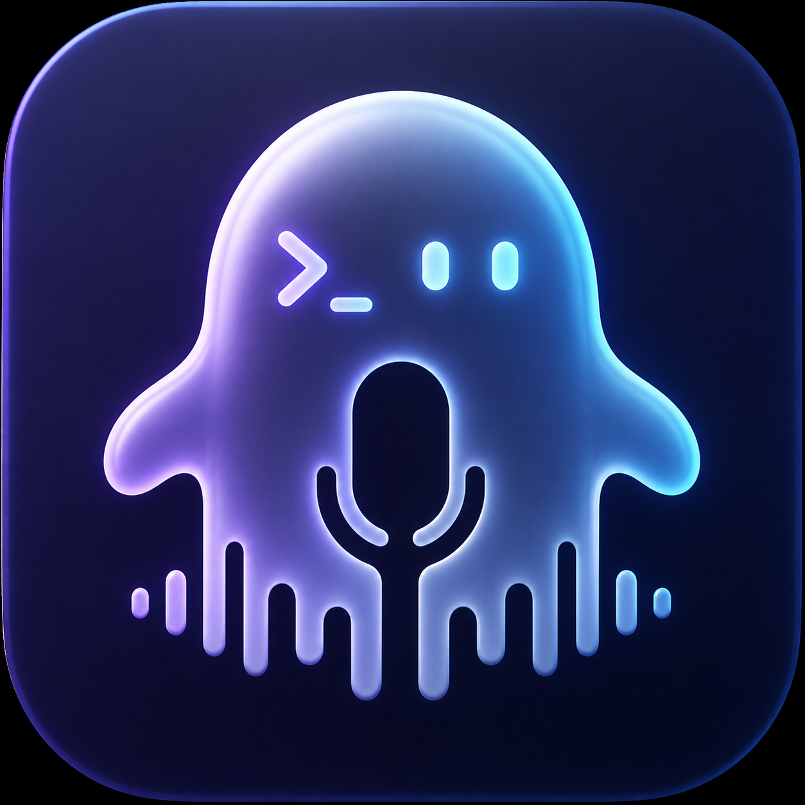
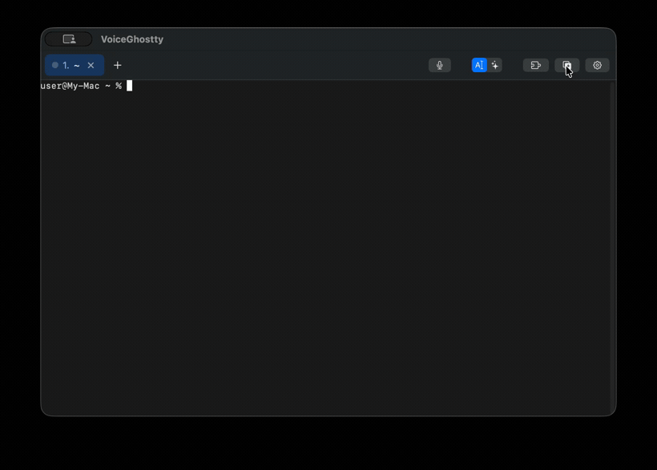

<div align="center">



# VoiceGhostty

**A voice-first terminal for Claude Code — hold space, talk, and your words land at the command line.**

[](https://github.com/10XTeams/VoiceGhostty/actions/workflows/release.yml)
[](https://github.com/10XTeams/VoiceGhostty/releases)
[](https://github.com/10XTeams/VoiceGhostty/stargazers)

[](LICENSE)

[**中文文档 →**](README.zh-CN.md)



</div>

## Highlights

- 🎙 **Hold Space to talk** — offline whisper recognition with live captions; text lands at the cursor. **Never auto-presses Enter** — you decide what runs.
- 🧠 **Say what you want, get the command** — *"undo the last commit but keep the changes"* → `git reset --soft HEAD~1`, with a one-line explanation. Claude API or local Ollama.
- 🚦 **See who's waiting on you** — a light per pane: idle / running / done / **needs your input** (Claude asking for permission, `[y/N]`). A chime when it turns green, a notification when you're away.
- 📈 **See where your tokens go** — <kbd>⌘I</kbd> shows Claude Code usage and cost by model, project and session, a prompt-cache countdown, and tips to save. Local only, no API calls.
- 🧩 **One-click skills, agents & plugins** — check them and they're installed into the project's `.claude/` and reloaded.
- 🗂 **Tabs & any-depth splits** — nest, drag to resize, move between tabs without interrupting the shell.

Full feature list: [docs/FEATURES.md](docs/FEATURES.md)

## Install

```bash
brew install --cask 10xteams/tap/voiceghostty
```

Or download from [Releases](https://github.com/10XTeams/VoiceGhostty/releases), move it to `/Applications`, and run `xattr -cr /Applications/VoiceGhostty.app` (the build isn't notarized).
On first launch you'll be offered a one-click speech-model download.

Build from source (needs Rust and cmake):

```bash
git clone https://github.com/10XTeams/VoiceGhostty.git && cd VoiceGhostty
./make-app.sh                                       # macOS
cargo run --release -p vg-app --features whisper    # Linux / Windows
```

## Key shortcuts

| | macOS |
|---|---|
| Talk | Hold <kbd>Space</kbd> |
| Dictation / natural-language mode | <kbd>⌘⇧N</kbd> |
| Undo last voice input | <kbd>⌘Z</kbd> |
| Split | <kbd>⌘D</kbd> / <kbd>⌘⇧D</kbd> |
| Pane list · loader · usage insights | <kbd>⌘B</kbd> · <kbd>⌘L</kbd> · <kbd>⌘I</kbd> |
| Settings · all shortcuts | <kbd>⌘,</kbd> · <kbd>⌘/</kbd> |

On Linux / Windows most use <kbd>Ctrl⇧</kbd> in place of <kbd>⌘</kbd>; the in-app table (<kbd>⌘/</kbd>) has the exact keys.

## Configuration

Most options live in the Settings window (<kbd>⌘,</kbd>). Advanced ones go in `~/.config/voiceghostty/config`; every key is listed in [FEATURES](docs/FEATURES.md).

## Built with

Rust · [egui](https://github.com/emilk/egui) · [alacritty_terminal](https://crates.io/crates/alacritty_terminal) · [whisper.cpp](https://github.com/ggml-org/whisper.cpp).
Semantic versioning; see the [CHANGELOG](CHANGELOG.md).

## License

[MIT](LICENSE) © 10XTeams. If it's useful to you, a ⭐ helps.
