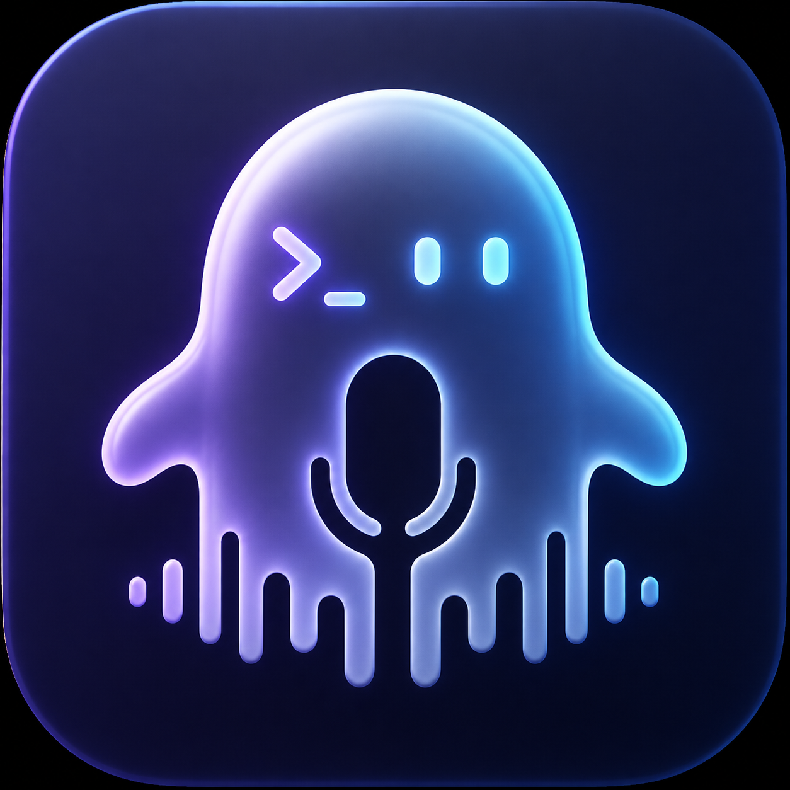
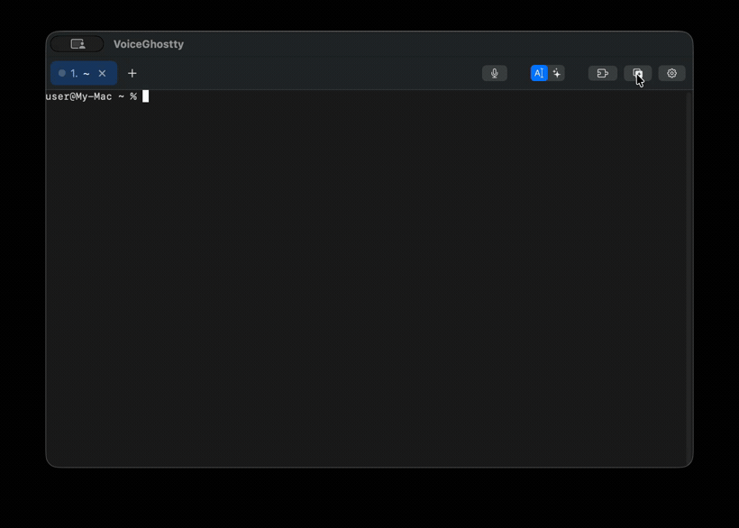

<div align="center">



# VoiceGhostty

**A voice-first terminal for Claude Code — hold space, talk, and your words land at the command line.**

Written in Rust. Prebuilt for macOS, builds from source on Linux / Windows. Push-to-talk, offline whisper recognition, natural-language → command, tabs & splits, and one-click Claude Code *skill* loading.

[](https://github.com/10XTeams/VoiceGhostty/actions/workflows/release.yml)
[](https://github.com/10XTeams/VoiceGhostty/releases)
[](https://github.com/10XTeams/VoiceGhostty/stargazers)


[](LICENSE)

[**中文文档 →**](README.zh-CN.md)

</div>

---

<div align="center">



</div>

## Why

Working with [Claude Code](https://claude.com/claude-code) means a lot of "type a command, run it, read output, type again." VoiceGhostty keeps your hands off the keyboard for the *talking* parts:

- **Talk instead of type.** Hold <kbd>Space</kbd> to dictate straight into the shell prompt.
- **Say what you want, get the command.** Natural-language mode turns *"undo the last commit but keep the changes"* into `git reset --soft HEAD~1` — with a one-line explanation before you run it.
- **Never surprise-executes.** Recognized text is dropped at the cursor with newlines stripped. **You** press Enter. Always.
- **Load Claude Code skills, agents and plugins on the fly.** Add folders once; each is scanned for all three, and the 🧩 panel gives each kind its own tab. Skills and agents are synced into the current project's `.claude/` followed by `/reload-skills`; plugins are switched on for this project alone.

## Features

| | |
|---|---|
| 🎙 **Push-to-talk** | Hold <kbd>Space</kbd> (≥0.25s) to record, release to stop. A quick tap still types a space. Or <kbd>⌘⇧M</kbd> to toggle. |
| 🔌 **Pluggable recognition** | Built-in [whisper.cpp](https://github.com/ggml-org/whisper.cpp) (offline, Metal-accelerated on macOS, model preloaded at launch); or any **external command** that reads a WAV and prints text; or an OpenAI-compatible **HTTP transcription API** (OpenAI, Groq, a local faster-whisper…). `auto` picks whatever is available. |
| 🧠 **Two voice modes** | *Dictation* (verbatim) and *Natural language* (Claude API or local Ollama → command + explanation, optionally with an Ollama cleanup pass first). <kbd>⌘⇧N</kbd> toggles. |
| 🌏 **Chinese & English** | Recognition language `zh` / `en` / `auto`. Automatic punctuation is on by default; turn it off when you mostly dictate shell commands. |
| 🚦 **Status lights** | Every tab and pane shows gray / yellow / green — idle, running, finished-and-waiting-on-you. Exact under zsh via shell integration; inferred from output and bells inside full-screen programs like `claude` or `vim`. The pane you're looking at stays gray; background windows still update. |
| 🔔 **Done chime** | A synthesized sound the moment a pane turns green, at most once every 5 seconds, switchable in Settings. |
| 🗂 **Tabs & nested splits** | <kbd>⌘T</kbd> / <kbd>⌘W</kbd>, <kbd>⌘1…⌘9</kbd>. <kbd>⌘D</kbd> / <kbd>⌘⇧D</kbd> split the **active pane** and repeat: three <kbd>⌘D</kbd> give three even columns, a perpendicular split makes a grid; the new pane's shell starts in the original pane's current directory. <kbd>⌘⌥</kbd>+arrows move focus across the split tree. Tabs name themselves after their working directory; double-click to rename, middle-click to close. |
| ↗️ **Move a split to another tab** | <kbd>⌘⌃1…8</kbd> sends the focused pane to the Nth tab, <kbd>⌘⌃←→</kbd> to the neighbouring tab, <kbd>⌘⌃T</kbd> out into a tab of its own. The shell keeps running and scrollback comes along. |
| 🧩 **Dynamic skill / agent loading** | Checkbox panel (<kbd>⌘L</kbd>): a folder's skills (subfolders with `SKILL.md`) and agents (`.md` files with front matter) are found automatically; apply and they're copied into `cwd/.claude/skills/` and `cwd/.claude/agents/`, never overwriting what's there; unchecking removes them. Auto-runs `/reload-skills` and `/reload-plugins`. |
| 🧩 **Per-project plugins** | A folder carrying `.claude-plugin/marketplace.json` (or `plugin.json`) lists its plugins in the Plugins tab. Checking one edits only `enabledPlugins` and `extraKnownMarketplaces` in `cwd/.claude/settings.local.json`; everything else in that file is left alone. |
| 🧩 **No duplicate names** | A skill, agent or plugin name offered by two folders is owned by the first folder in the list; the later one is shown disabled and badged *duplicate*. |
| 📊 **Claude context usage** | While Claude Code runs in the foreground pane, the status bar shows `claude ▬ 65K / 1M · 7%`, read from the transcripts under `~/.claude/projects/`. Orange at 70%, red at 90%. |
| 🎨 **Themes & search** | Dark / Light / Solarized Dark / Dracula, with the whole UI palette derived from the terminal theme. <kbd>⌘F</kbd> searches scrollback and selects the match so you can copy it; live font resize; <kbd>⌘K</kbd> clear. |
| 📜 **Session history** | Every pane writes `~/.config/voiceghostty/history/<folder>-<start time>.log` — what the terminal actually displayed, not the raw byte stream. |
| ✨ **Claude quick-launch** | Save project dirs; one click runs `cd <dir> && claude` in the active pane. |
| ⚙️ **Settings panel** | <kbd>⌘,</kbd>: speech engine, recognition language, punctuation, done chime, session history, default folder for new tabs, scrollback lines, theme, command-input color, loader folders. Changes apply immediately and win over the config file. |
| 🎨 **Colored input** | The command line you type at the zsh prompt is highlighted in a color you choose; changing it applies live to every open tab. |
| 🔒 **Safe by design** | Voice never auto-presses Enter. Newlines are stripped before insertion. With built-in whisper, audio never leaves your machine. API keys stay in a local config file. |

Full inventory with implementation notes: [**docs/FEATURES.md**](docs/FEATURES.md).

## Shortcuts

Press <kbd>⌘/</kbd> in the app for the full table. Linux / Windows don't use plain Ctrl combinations because Ctrl+T, Ctrl+W and Ctrl+D all mean something in the shell.

| Action | macOS | Linux / Windows |
|---|---|---|
| Talk (tap = space) | Hold <kbd>Space</kbd> | Hold <kbd>Space</kbd> |
| Start / stop recording · toggle voice mode | <kbd>⌘⇧M</kbd> / <kbd>⌘⇧N</kbd> | <kbd>Ctrl⇧M</kbd> / <kbd>Ctrl⇧N</kbd> |
| New / close (pane first, then tab) | <kbd>⌘T</kbd> / <kbd>⌘W</kbd> | <kbd>Ctrl⇧T</kbd> / <kbd>Ctrl⇧W</kbd> |
| Split right / down (repeatable) | <kbd>⌘D</kbd> / <kbd>⌘⇧D</kbd> | <kbd>Ctrl⇧D</kbd> / <kbd>Ctrl⇧E</kbd> |
| Move split focus | <kbd>⌘⌥</kbd>←↑↓→ | <kbd>Ctrl Alt</kbd>←↑↓→ |
| Send split to Nth tab | <kbd>⌘⌃1…8</kbd> | <kbd>Ctrl Alt 1…8</kbd> |
| Send split to previous / next / new tab | <kbd>⌘⌃←</kbd> / <kbd>⌘⌃→</kbd> / <kbd>⌘⌃T</kbd> | <kbd>Ctrl Alt ⇧←</kbd> / <kbd>→</kbd> / <kbd>T</kbd> |
| Next / previous tab | <kbd>⌘⇧]</kbd> / <kbd>⌘⇧[</kbd> | <kbd>Ctrl PageDown</kbd> / <kbd>PageUp</kbd> |
| Nth / last tab | <kbd>⌘1…8</kbd> / <kbd>⌘9</kbd> | <kbd>Alt 1…8</kbd> / <kbd>Alt 9</kbd> |
| Search / clear / select all | <kbd>⌘F</kbd> / <kbd>⌘K</kbd> / <kbd>⌘A</kbd> | <kbd>Ctrl⇧F</kbd> / <kbd>K</kbd> / <kbd>A</kbd> |
| Copy | <kbd>⌘C</kbd> | <kbd>Ctrl⇧C</kbd> (plain Ctrl+C still interrupts) |
| Loader / settings / shortcut table | <kbd>⌘L</kbd> / <kbd>⌘,</kbd> / <kbd>⌘/</kbd> | <kbd>Ctrl⇧L</kbd> / <kbd>,</kbd> / <kbd>/</kbd> |
| Font size | <kbd>⌘+</kbd> <kbd>⌘-</kbd> <kbd>⌘0</kbd> | <kbd>Ctrl⇧+</kbd> <kbd>-</kbd> <kbd>0</kbd> |

## Install

> **A note on signing.** macOS builds are ad-hoc signed and **not notarized** — notarization requires a paid
> Apple Developer Program membership. macOS will therefore refuse to open a downloaded build until its
> quarantine flag is cleared. Every option below deals with that.

### Option A — Homebrew (fastest)

```bash
brew install --cask 10xteams/tap/voiceghostty
```

The cask clears the quarantine flag for you after install, so the app just opens. Upgrade with
`brew upgrade --cask voiceghostty`, remove with `brew uninstall --cask voiceghostty` (add `--zap` to also
delete `~/.config/voiceghostty`).

### Option B — download a build

Grab the latest `.zip` from [**Releases**](https://github.com/10XTeams/VoiceGhostty/releases), unzip,
move it to `/Applications`, then clear the quarantine flag once:

```bash
xattr -cr /Applications/VoiceGhostty.app
open /Applications/VoiceGhostty.app
```

If you'd rather not run `xattr`, double-click the app, let it be blocked, then go to **System Settings →
Privacy & Security**, scroll to the bottom and click **Open Anyway**.

Grant **Microphone** access when macOS prompts.

### Option C — build from source

You need stable [Rust](https://rustup.rs); building the built-in whisper engine also needs cmake
(macOS: `brew install cmake`).

```bash
git clone https://github.com/10XTeams/VoiceGhostty.git
cd VoiceGhostty
./make-app.sh          # macOS: release build (whisper + Metal), package the .app, launch
```

> The microphone permission dialog needs the `Info.plist` inside an app bundle, so on macOS use
> `make-app.sh` rather than `cargo run`. A locally built app is never quarantined — nothing to bypass.

On Linux / Windows run the executable directly (`--features whisper`, without Metal):

```bash
cargo run --release -p vg-app --features whisper
cargo test --workspace
```

## Speech engines

Recognized text is only inserted, never executed. With `voice-engine = auto` the order is: built-in whisper
(compiled in and a model present) → external command → API key → an HTTP URL pointing at localhost.

**Built-in whisper (offline, recommended).** Put a whisper.cpp model (`ggml-*.bin`) into
`~/.config/voiceghostty/models/`, or point `voice-model = <path>` at one. The model is loaded in the
background at launch, so the first utterance doesn't wait.

```bash
mkdir -p ~/.config/voiceghostty/models
curl -L -o ~/.config/voiceghostty/models/ggml-large-v3-turbo.bin \
  https://huggingface.co/ggerganov/whisper.cpp/resolve/main/ggml-large-v3-turbo.bin
```

Model choice: `base` (~150MB) is good for English; for Chinese use `small` or larger, or `large-v3-turbo` (~1.6GB).

**External command.** Anything that turns a WAV file into text. `{wav}` becomes the path of a 16 kHz mono
WAV temp file, `{lang}` the recognition language; stdout is the transcript:

```ini
voice-engine  = command
voice-command = whisper-cli -m ~/models/ggml-large-v3-turbo.bin -l {lang} -nt -np -f {wav}
```

**OpenAI-compatible HTTP API.** OpenAI, Groq and friends, or a local faster-whisper-server, speaches or
whisper.cpp server. A localhost URL needs no key and bypasses the system proxy automatically.

```ini
voice-engine    = http
voice-api-url   = https://api.openai.com/v1/audio/transcriptions
voice-api-key   = sk-...        # blank: falls back to $VOICE_API_KEY, then $OPENAI_API_KEY
voice-api-model = whisper-1
```

## Configuration

`~/.config/voiceghostty/config` (`%APPDATA%\voiceghostty\config` on Windows) — simple `key = value`, `#` for comments:

```ini
font-family = Menlo
font-size   = 13
theme       = dracula          # dark | light | solarized-dark | dracula
foreground  = #f8f8f2          # optional, overrides the theme's foreground
background  = #282a36          # optional, overrides the theme's background
scrollback  = 10000            # lines kept per pane (Settings overrides this)

# Speech (see the section above)
voice-engine      = auto       # auto | whisper | http | command | off
voice-language    = zh         # zh | en | auto
voice-punctuation = on         # off when you mostly dictate shell commands
voice-hold-ms     = 250        # how long a Space press counts as push-to-talk
voice-device      =            # microphone name, blank = system default

# Natural-language mode
llm-provider = auto            # auto | claude | ollama (auto: Claude with a key, else Ollama)
llm-model    = claude-opus-5-5
llm-api-key  = sk-ant-...      # or leave blank to read $ANTHROPIC_API_KEY

# Transcript correction for natural-language mode (local, offline)
correction      = on
llm-local-model = qwen3:1.7b   # cleanup; also generates commands when there is no Claude key
llm-local-url   = http://127.0.0.1:11434

# Skill libraries the 🧩 panel lists from (comma-separate or repeat the key for several)
skill-library-dir = ~/.claude/skills, ~/work/team-skills
```

Unknown keys and malformed lines are ignored, never an error. Every key is documented in [docs/FEATURES.md](docs/FEATURES.md).

> Apps launched from Finder don't inherit your shell env, so put the API key in the config file and `chmod 600` it.

**In-app Settings (<kbd>⌘,</kbd>).** Speech engine, recognition language, punctuation, done chime, session
history, default folder for new tabs, scrollback lines, command-input color and loader folders are editable in the panel, saved to
`settings.json`, and win over the config file.

### Optional: local Ollama

```bash
brew install ollama
brew services start ollama
ollama pull qwen3:1.7b        # ~1.4GB
```

No further configuration: natural-language mode runs the transcript through it before the LLM, and without a
Claude key it generates the command too. If Ollama isn't running or times out, the raw transcript is used
silently. Dictation mode never goes through it — what you say is typed verbatim.

### Shell integration

VoiceGhostty generates a ZDOTDIR wrapper at `~/.config/voiceghostty/shell-rs/` that sources your real `~/.z*`
files first, then appends two things: a `line-pre-redraw` hook that colors your prompt input (re-reading
`~/.config/voiceghostty/input-color` each redraw, so a color change is live in every open tab), and
command start / end markers (state files under `run/`) that drive the status lights. Your own prompt, past
output and full-screen TUIs like `claude` are untouched, and only zsh is instrumented.

## How it works

```
Mic (cpal → 16 kHz resample → trim leading/trailing silence)
  → speech engine (built-in whisper.cpp / external command / OpenAI-compatible HTTP)
  → text
     ├─ [Dictation]        verbatim
     └─ [Natural language] optional Ollama cleanup → LLM → command + explanation
                              ├─ Claude API
                              └─ local Ollama
  → strip newlines → drop at terminal cursor  ★ never auto-Enter ★
  → you press Enter → alacritty_terminal → PTY → zsh
```

Built on [egui](https://github.com/emilk/egui), [alacritty_terminal](https://crates.io/crates/alacritty_terminal), [cpal](https://github.com/RustAudio/cpal) and [whisper-rs](https://github.com/tazz4843/whisper-rs).

| crate | Contents |
|---|---|
| `vg-core` | Config, GUI settings, themes, natural language → command (Claude / Ollama), zsh integration, loader. No GUI dependencies |
| `vg-voice` | Microphone capture, resampling, silence trimming, pluggable speech engines, chime |
| `vg-app` | egui window + alacritty_terminal + push-to-talk + the voice pipeline |

## Versioning

The version is defined once, in `[workspace.package]` in `Cargo.toml`. Packaging writes it into `Info.plist`;
`build.rs` injects the git commit into the binary, and the Settings window shows `v0.1.0 (abc1234+)` at the
bottom, the `+` meaning uncommitted changes were present. To release, push a matching tag (`v0.1.0`): CI builds
the .app and creates the GitHub Release, then `scripts/release-cask.sh` updates the Homebrew cask.

## Roadmap

- [x] Voice dictation, insert-at-cursor (never auto-Enter); built-in offline whisper.cpp
- [x] Tabs / nested splits / move splits between tabs / themes / search / config file
- [x] Natural language → command (Claude API **and** local Ollama)
- [x] Dynamic Claude Code skill, agent and plugin loading
- [x] zsh integration: status lights, done chime, colored input line, cwd-derived tab titles
- [x] Session transcripts on disk, Claude context usage display
- [ ] One-click whisper model download on first launch
- [ ] English UI
- [ ] Prebuilt Linux / Windows packages
- [ ] Command-context awareness, dangerous-command tiering, voice edits, TTS readback

The earlier Swift implementation is preserved at the git tag `swift-final`.

## Contributing

Issues and PRs welcome. If VoiceGhostty is useful to you, a ⭐ genuinely helps others find it.

## License

[MIT](LICENSE) © 10XTeams
