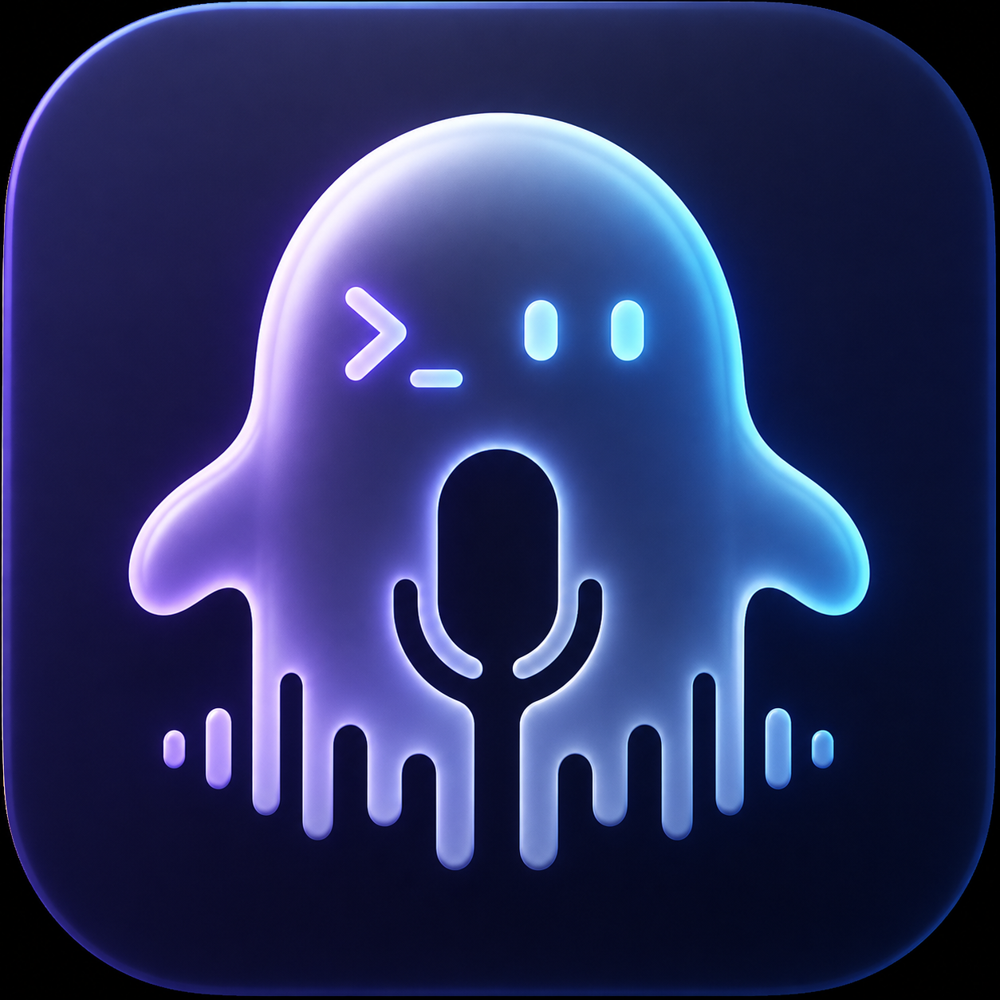
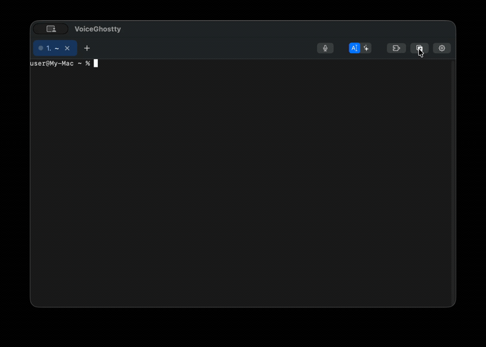

<div align="center">



# VoiceGhostty

**为 Claude Code 打造的语音优先终端 —— 按住空格说话,话就落在命令行上。**

Rust 编写,macOS 预编译发布,Linux / Windows 可从源码构建。按住说话、离线 whisper 识别、自然语言转命令、标签与分屏、一键加载 Claude Code *技能*。

[](https://github.com/10XTeams/VoiceGhostty/actions/workflows/release.yml)
[](https://github.com/10XTeams/VoiceGhostty/releases)
[](https://github.com/10XTeams/VoiceGhostty/stargazers)


[](LICENSE)

[**English →**](README.md)

</div>

---

<div align="center">



</div>

## 为什么

用 [Claude Code](https://claude.com/claude-code) 干活,大量时间花在「敲命令、执行、看输出、再敲」上。VoiceGhostty 让「说」这部分不用碰键盘:

- **说,而不是敲。** 按住 <kbd>空格</kbd>,直接把话听写到 shell 提示符上。
- **说想干什么,拿到命令。** 自然语言模式把「撤销上一次提交但保留改动」变成 `git reset --soft HEAD~1`,并在执行前给你一句解释。
- **绝不会突然自己执行。** 识别结果剥离换行后落在光标处,回车永远由**你**来按。
- **随手加载 Claude Code 技能、Agent 与插件。** 文件夹添加一次,里面的技能、Agent、插件会被同时识别出来,在 🧩 面板里分成三个页签。技能与 Agent 同步进当前项目的 `.claude/` 并自动发 `/reload-skills`;插件则只为当前项目启用。

## 功能

| | |
|---|---|
| 🎙 **按住说话** | 按住 <kbd>空格</kbd>(≥0.25 秒)录音,松开即停;快速点按仍是正常输入空格。也可用 <kbd>⌘⇧M</kbd> 开关。 |
| 🔌 **可插拔识别引擎** | 内置 [whisper.cpp](https://github.com/ggml-org/whisper.cpp)(本地离线,macOS 用 Metal 加速,模型启动时后台预载);也可接任何读 WAV 出文字的**外部命令**,或 OpenAI 兼容的 **HTTP 转写接口**(OpenAI、Groq、本机 faster-whisper 等)。`auto` 按可用性自动挑。 |
| 🧠 **两种语音模式** | *听写*(说什么敲什么)与*自然语言*(Claude API 或本地 Ollama → 命令 + 解释;可选先用 Ollama 小模型纠错)。<kbd>⌘⇧N</kbd> 切换。 |
| 🌏 **中英识别** | 识别语言 `zh` / `en` / `auto`,默认自动加标点,主要口述 shell 命令时建议关掉。 |
| 🚦 **状态灯** | 每个标签页和分屏都有灰 / 黄 / 绿三态点:空闲、执行中、已完成等你处理。zsh 下靠 shell 集成精确判断;`claude`、`vim` 这类全屏程序按输出和响铃推断。你正在看的窗格保持灰色;窗口在后台也照常变色。 |
| 🔔 **完成提示音** | 窗格变绿的那一刻响一声合成提示音,5 秒内最多一次,设置里可关。 |
| 🗂 **标签与嵌套分屏** | <kbd>⌘T</kbd> / <kbd>⌘W</kbd>、<kbd>⌘1…⌘9</kbd>。<kbd>⌘D</kbd> / <kbd>⌘⇧D</kbd> 拆的是**当前分屏**且可反复按:连按三次 <kbd>⌘D</kbd> 得到三等分,换个方向再拆就是网格;新格在原窗格当前目录里开 shell。<kbd>⌘⌥</kbd>+方向键按分屏树切焦点。标签名跟随工作目录,双击改名,中键关闭。 |
| ↗️ **分屏跨标签页移动** | <kbd>⌘⌃1…8</kbd> 把当前格送到第 N 个标签页,<kbd>⌘⌃←→</kbd> 送到相邻标签页,<kbd>⌘⌃T</kbd> 移出成新标签页。shell 不中断、滚动历史一起过去。 |
| 🧩 **动态加载技能 / Agent** | 勾选式面板(<kbd>⌘L</kbd>):自动识别文件夹里的技能(带 `SKILL.md` 的子文件夹)和 Agent(带 front matter 的 `.md`),应用后复制进 `cwd/.claude/skills/` 与 `cwd/.claude/agents/`,已存在的不覆盖,取消勾选即移除,随后自动发送 `/reload-skills` 与 `/reload-plugins`。 |
| 🧩 **项目级插件** | 文件夹带 `.claude-plugin/marketplace.json`(或 `plugin.json`)时,它的插件出现在「插件」页签。勾选后只改 `cwd/.claude/settings.local.json` 里的 `enabledPlugins` 与 `extraKnownMarketplaces`,其他设置原样保留。 |
| 🧩 **不允许重名** | 同名的技能 / Agent / 插件只由列表靠前的文件夹提供,靠后的那行勾不动并标「重名」。 |
| 📊 **Claude 上下文占用** | 窗格前台在跑 Claude Code 时,状态栏显示 `claude ▬ 65K / 1M · 7%`,读自 `~/.claude/projects/` 下的记录;到 70% 变橙、90% 变红。 |
| 🎨 **主题与搜索** | 暗色 / 亮色 / Solarized Dark / Dracula,整套界面配色从终端主题推导;<kbd>⌘F</kbd> 搜索滚动历史,找到的内容直接选中可复制;字号实时缩放,<kbd>⌘K</kbd> 清屏。 |
| 📜 **会话历史** | 每个分屏写一份 `~/.config/voiceghostty/history/<目录>-<时间>.log`,记录的是终端最终显示的内容,不是原始字节流。 |
| ✨ **Claude 快捷启动** | 保存常用项目目录,点一下就在当前分屏执行 `cd <目录> && claude`。 |
| ⚙️ **设置面板** | <kbd>⌘,</kbd>:语音引擎、识别语言、自动标点、完成提示音、会话历史、历史行数、主题、命令输入颜色、加载文件夹,改动立即生效,优先级高于配置文件。 |
| 🎨 **输入行着色** | 你在 zsh 提示符下敲的整行命令按设定颜色高亮;改色后所有已打开标签页即刻生效。 |
| 🔒 **安全优先** | 语音绝不自动回车,插入前剥离换行;内置 whisper 时音频不出本机;API Key 只存在本地配置文件里。 |

完整功能清单(含实现说明):[**docs/FEATURES.zh-CN.md**](docs/FEATURES.zh-CN.md)。

## 快捷键

按 <kbd>⌘/</kbd> 在 app 内查看完整快捷键表。Linux / Windows 上不用单独的 Ctrl 组合键,因为 Ctrl+T、Ctrl+W、Ctrl+D 在 shell 里都有用。

| 功能 | macOS | Linux / Windows |
|---|---|---|
| 说话(点按 = 空格) | 按住 <kbd>空格</kbd> | 按住 <kbd>空格</kbd> |
| 开始 / 停止录音 · 切换语音模式 | <kbd>⌘⇧M</kbd> / <kbd>⌘⇧N</kbd> | <kbd>Ctrl⇧M</kbd> / <kbd>Ctrl⇧N</kbd> |
| 新建 / 关闭(先关分屏,再关标签页) | <kbd>⌘T</kbd> / <kbd>⌘W</kbd> | <kbd>Ctrl⇧T</kbd> / <kbd>Ctrl⇧W</kbd> |
| 向右 / 向下分屏(可反复) | <kbd>⌘D</kbd> / <kbd>⌘⇧D</kbd> | <kbd>Ctrl⇧D</kbd> / <kbd>Ctrl⇧E</kbd> |
| 切换分屏焦点 | <kbd>⌘⌥</kbd>←↑↓→ | <kbd>Ctrl⌥</kbd>←↑↓→ |
| 分屏送到第 N 个标签页 | <kbd>⌘⌃1…8</kbd> | <kbd>Ctrl⌥1…8</kbd> |
| 分屏送到上一个 / 下一个 / 新标签页 | <kbd>⌘⌃←</kbd> / <kbd>⌘⌃→</kbd> / <kbd>⌘⌃T</kbd> | <kbd>Ctrl⌥⇧←</kbd> / <kbd>→</kbd> / <kbd>T</kbd> |
| 下一个 / 上一个标签页 | <kbd>⌘⇧]</kbd> / <kbd>⌘⇧[</kbd> | <kbd>Ctrl PageDown</kbd> / <kbd>PageUp</kbd> |
| 第 N 个 / 最后一个标签页 | <kbd>⌘1…8</kbd> / <kbd>⌘9</kbd> | <kbd>Alt 1…8</kbd> / <kbd>Alt 9</kbd> |
| 搜索 / 清屏 / 全选 | <kbd>⌘F</kbd> / <kbd>⌘K</kbd> / <kbd>⌘A</kbd> | <kbd>Ctrl⇧F</kbd> / <kbd>K</kbd> / <kbd>A</kbd> |
| 复制 | <kbd>⌘C</kbd> | <kbd>Ctrl⇧C</kbd>(单独的 Ctrl+C 仍是中断) |
| 加载器 / 设置 / 快捷键表 | <kbd>⌘L</kbd> / <kbd>⌘,</kbd> / <kbd>⌘/</kbd> | <kbd>Ctrl⇧L</kbd> / <kbd>,</kbd> / <kbd>/</kbd> |
| 字号 | <kbd>⌘+</kbd> <kbd>⌘-</kbd> <kbd>⌘0</kbd> | <kbd>Ctrl⇧+</kbd> <kbd>-</kbd> <kbd>0</kbd> |

## 安装

> **关于签名。** macOS 构建产物是 ad-hoc 签名、**未经 Apple 公证** —— 公证需要付费的 Apple Developer Program 会员。
> 因此下载下来的构建在清除隔离属性前,macOS 会拒绝打开。下面三种方式都各自处理了这一点。

### 方式 A —— Homebrew(最快)

```bash
brew install --cask 10xteams/tap/voiceghostty
```

cask 会在安装后替你清除隔离属性,装完直接能开。升级 `brew upgrade --cask voiceghostty`,卸载 `brew uninstall --cask voiceghostty`(加 `--zap` 会一并删除 `~/.config/voiceghostty`)。

### 方式 B —— 直接下载

从 [**Releases**](https://github.com/10XTeams/VoiceGhostty/releases) 下载最新 `.zip` 解压,移到 `/Applications`,然后清一次隔离属性:

```bash
xattr -cr /Applications/VoiceGhostty.app
open /Applications/VoiceGhostty.app
```

不想跑 `xattr` 的话:双击打开、让它被拦下,然后到**系统设置 → 隐私与安全性**,拉到底点**仍要打开**。

macOS 弹窗时授予**麦克风**权限。

### 方式 C —— 从源码构建

需要 [Rust](https://rustup.rs) 稳定版;编内置 whisper 还需要 cmake(macOS:`brew install cmake`)。

```bash
git clone https://github.com/10XTeams/VoiceGhostty.git
cd VoiceGhostty
./make-app.sh          # macOS:release 构建(含 whisper Metal)、打包 .app、启动
```

> 麦克风权限弹窗依赖 app bundle 里的 `Info.plist`,所以 macOS 上用 `make-app.sh`,不要直接 `cargo run`。
> 本地构建的 app 不会被打上隔离属性,没有需要绕过的东西。

Linux / Windows 直接跑可执行文件(其他平台用 `--features whisper`,不带 Metal):

```bash
cargo run --release -p vg-app --features whisper
cargo test --workspace
```

## 语音引擎

识别结果只上屏,不自动回车。`voice-engine = auto` 的选择顺序:内置 whisper(编译进来且有模型)→ 外部命令 → API Key → 指向本机的 HTTP 地址。

**内置 whisper(本地离线,推荐)。** 把 whisper.cpp 的模型文件(`ggml-*.bin`)放到 `~/.config/voiceghostty/models/`,或者用 `voice-model = <路径>` 指定。模型在启动时后台载入,第一次说话不用等。

```bash
mkdir -p ~/.config/voiceghostty/models
curl -L -o ~/.config/voiceghostty/models/ggml-large-v3-turbo.bin \
  https://huggingface.co/ggerganov/whisper.cpp/resolve/main/ggml-large-v3-turbo.bin
```

模型选择:`base` 约 150MB,英文效果很好;中文建议 `small` 以上,或 `large-v3-turbo`(约 1.6GB)。

**外部命令。** 任何能从 WAV 文件读出文字的程序都可以接进来,`{wav}` 替换成 16 kHz 单声道 WAV 临时文件路径,`{lang}` 替换成识别语言,stdout 就是识别结果:

```ini
voice-engine  = command
voice-command = whisper-cli -m ~/models/ggml-large-v3-turbo.bin -l {lang} -nt -np -f {wav}
```

**OpenAI 兼容 HTTP 接口。** OpenAI、Groq 等云服务,以及本机的 faster-whisper-server、speaches、whisper.cpp server 都可以用。地址指向本机时不需要 Key,并且会自动绕过系统代理。

```ini
voice-engine    = http
voice-api-url   = https://api.openai.com/v1/audio/transcriptions
voice-api-key   = sk-...        # 为空时依次读环境变量 VOICE_API_KEY、OPENAI_API_KEY
voice-api-model = whisper-1
```

## 配置

`~/.config/voiceghostty/config`(Windows 上是 `%APPDATA%\voiceghostty\config`),极简 `key = value`,`#` 注释:

```ini
font-family = Menlo
font-size   = 13
theme       = dracula          # dark | light | solarized-dark | dracula
foreground  = #f8f8f2          # 可选,覆盖主题前景色
background  = #282a36          # 可选,覆盖主题背景色
scrollback  = 10000            # 每个分屏保留的回滚行数(设置面板优先级更高)

# 语音(详见上一节)
voice-engine      = auto       # auto | whisper | http | command | off
voice-language    = zh         # zh | en | auto
voice-punctuation = on         # 主要口述 shell 命令时建议 off
voice-hold-ms     = 250        # 按住多久算"按住说话"
voice-device      =            # 麦克风名,留空用系统默认

# 自然语言模式
llm-provider = auto            # auto | claude | ollama(auto:有 Key 走 Claude,否则 Ollama)
llm-model    = claude-opus-5-5
llm-api-key  = sk-ant-...      # 留空则读 $ANTHROPIC_API_KEY

# 自然语言模式的文本矫正(本地离线)
correction      = on           # on | off
llm-local-model = qwen3:1.7b   # 纠错;没有 Claude Key 时也用它生成命令
llm-local-url   = http://127.0.0.1:11434

# 🧩 面板列出技能的来源目录(多个目录用英文逗号分隔,或重复写这个键)
skill-library-dir = ~/.claude/skills, ~/work/team-skills
```

未知键和坏行直接忽略,不会报错。全部键的说明见 [docs/FEATURES.zh-CN.md](docs/FEATURES.zh-CN.md)。

> 从 Finder 启动的 app 拿不到 shell 环境变量,所以推荐把 Key 写进配置文件并 `chmod 600`。

**app 内设置(<kbd>⌘,</kbd>)。** 语音引擎、识别语言、自动标点、完成提示音、会话历史、历史行数、命令输入颜色、加载文件夹都能在面板里直接改,存到 `settings.json`,优先级高于配置文件。

### 可选:本地 Ollama

```bash
brew install ollama
brew services start ollama    # 后台服务,开机自启
ollama pull qwen3:1.7b        # ~1.4GB
```

装好后无需任何配置:自然语言模式会先把识别文本过一遍矫正再送给 LLM;没有配置 Claude Key 时,命令也由它生成。Ollama 没在跑或超时,会静默使用原文,绝不阻塞。听写模式不走这条链路,说什么就逐字敲什么。

### Shell 集成

VoiceGhostty 会在 `~/.config/voiceghostty/shell-rs/` 生成一层 ZDOTDIR 包装:先 source 你真正的 `~/.z*` 文件,再追加两样东西 —— 一个 `line-pre-redraw` 钩子给提示符输入行上色(每次重绘都重读 `~/.config/voiceghostty/input-color`,所以改色在所有已打开标签页即刻生效),以及命令开始 / 结束的状态标记(写在 `run/` 目录下的状态文件里,驱动状态灯)。你自己的提示符、历史输出、`claude` 这类全屏 TUI 都不受影响,并且只对 zsh 做注入。

## 工作原理

```
麦克风(cpal → 16 kHz 重采样 → 裁掉首尾静音)
  → 识别引擎(内置 whisper.cpp / 外部命令 / OpenAI 兼容 HTTP)
  → 文本
     ├─ [听写模式]     原样
     └─ [自然语言模式] 可选 Ollama 纠错 → LLM → 命令 + 解释
                          ├─ Claude API
                          └─ 本地 Ollama
  → 剥离换行 → 落到终端光标处  ★ 绝不自动回车 ★
  → 你按回车 → alacritty_terminal → PTY → zsh
```

基于 [egui](https://github.com/emilk/egui)、[alacritty_terminal](https://crates.io/crates/alacritty_terminal)、[cpal](https://github.com/RustAudio/cpal) 与 [whisper-rs](https://github.com/tazz4843/whisper-rs) 构建。

| crate | 内容 |
|---|---|
| `vg-core` | 配置、GUI 设置、主题、自然语言→命令(Claude / Ollama)、zsh 集成、加载器。没有 GUI 依赖 |
| `vg-voice` | 麦克风采集、重采样、裁静音、可插拔识别引擎、提示音 |
| `vg-app` | egui 窗口 + alacritty_terminal 终端 + 按住说话 + 语音流水线 |

## 版本

版本号只在 `Cargo.toml` 的 `[workspace.package]` 里定义一处。打包时它被写进 `Info.plist`,git 提交号由 `build.rs` 注入二进制,设置窗口底部显示 `v0.1.0 (abc1234+)`,末尾的 `+` 表示带未提交改动。发版即推一个与之一致的 tag(如 `v0.1.0`),CI 会构建 .app、建 Release,再用 `scripts/release-cask.sh` 同步 Homebrew cask。

## 路线图

- [x] 语音听写,填到光标处(绝不自动回车);内置 whisper.cpp 离线识别
- [x] 标签 / 嵌套分屏 / 分屏跨标签页移动 / 主题 / 搜索 / 配置文件
- [x] 自然语言 → 命令(Claude API **与**本地 Ollama)
- [x] Claude Code 技能、Agent、插件动态加载
- [x] zsh 集成:状态灯、完成提示音、输入行着色、标签名跟随工作目录
- [x] 会话记录落盘、Claude 上下文占用显示
- [ ] 首次启动一键下载 whisper 模型
- [ ] 英文界面
- [ ] Linux / Windows 预编译包
- [ ] 命令上下文感知、危险命令分级、语音修正、TTS 朗读

Swift 版实现保留在 git 标签 `swift-final` 上。

## 参与贡献

欢迎 Issue 与 PR。如果 VoiceGhostty 对你有用,点个 ⭐ 能实实在在帮到更多人。

## 许可

[MIT](LICENSE) © 10XTeams
