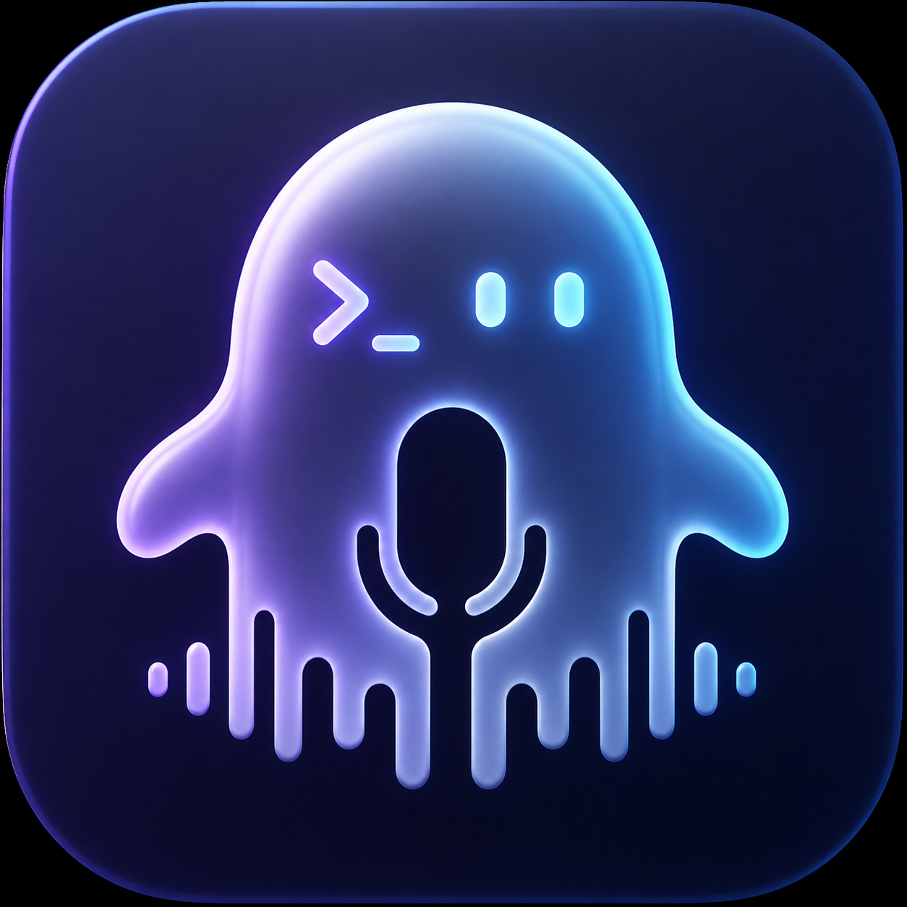
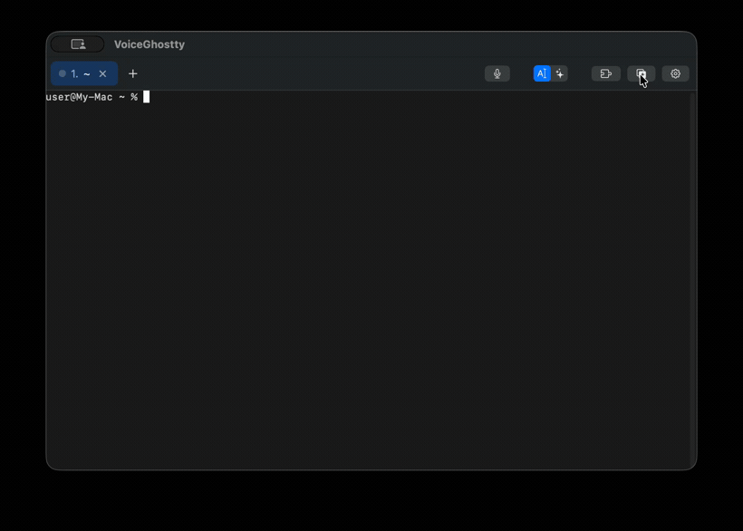

<div align="center">



# VoiceGhostty

**为 Claude Code 打造的语音优先终端 —— 按住空格说话,话就落在命令行上。**

[](https://github.com/10XTeams/VoiceGhostty/actions/workflows/release.yml)
[](https://github.com/10XTeams/VoiceGhostty/releases)
[](https://github.com/10XTeams/VoiceGhostty/stargazers)

[](LICENSE)

[**English →**](README.md)



</div>

## 亮点

- 🎙 **按住空格说话** —— 离线 whisper 识别,边说边出字幕,结果落在光标处。**绝不自动回车**,执行永远由你决定。
- 🧠 **说意图,拿命令** —— 「撤销上一次提交但保留改动」→ `git reset --soft HEAD~1`,附一句解释。支持 Claude API 或本地 Ollama。
- 🚦 **一眼看出谁在等你** —— 每个窗格一盏灯:空闲 / 执行中 / 已完成 / **等你输入**(Claude 请求批准、`[y/N]`)。变绿时响一声,后台时发通知。
- 📈 **看清 token 花在哪** —— <kbd>⌘I</kbd> 按模型、项目、会话看 Claude Code 的用量和费用,提示缓存倒计时,外加省钱建议。只读本机,不调 API。
- 🧩 **一键加载技能、Agent、插件** —— 勾选即装进当前项目的 `.claude/`,自动重载。
- 🗂 **标签与任意分屏** —— 嵌套分屏、拖动调整、跨标签页移动,shell 不中断。

完整功能清单:[docs/FEATURES.zh-CN.md](docs/FEATURES.zh-CN.md)

## 安装

```bash
brew install --cask 10xteams/tap/voiceghostty
```

或从 [Releases](https://github.com/10XTeams/VoiceGhostty/releases) 下载,移到 `/Applications` 后执行 `xattr -cr /Applications/VoiceGhostty.app`(未经 Apple 公证)。
首次启动会提示下载语音模型,点一下即可。

从源码构建(需要 Rust 和 cmake):

```bash
git clone https://github.com/10XTeams/VoiceGhostty.git && cd VoiceGhostty
./make-app.sh                                       # macOS
cargo run --release -p vg-app --features whisper    # Linux / Windows
```

## 常用快捷键

| | macOS |
|---|---|
| 说话 | 按住 <kbd>空格</kbd> |
| 听写 / 自然语言 切换 | <kbd>⌘⇧N</kbd> |
| 撤销上一次语音输入 | <kbd>⌘Z</kbd> |
| 分屏 | <kbd>⌘D</kbd> / <kbd>⌘⇧D</kbd> |
| 窗格列表 · 加载器 · 用量洞察 | <kbd>⌘B</kbd> · <kbd>⌘L</kbd> · <kbd>⌘I</kbd> |
| 设置 · 全部快捷键 | <kbd>⌘,</kbd> · <kbd>⌘/</kbd> |

Linux / Windows 上大多用 <kbd>Ctrl⇧</kbd> 代替 <kbd>⌘</kbd>,以 app 内 <kbd>⌘/</kbd> 的快捷键表为准。

## 配置

大部分选项在设置窗口(<kbd>⌘,</kbd>)里改。进阶选项写在 `~/.config/voiceghostty/config`,全部键见 [FEATURES](docs/FEATURES.zh-CN.md#17-配置文件)。

## 技术栈

Rust · [egui](https://github.com/emilk/egui) · [alacritty_terminal](https://crates.io/crates/alacritty_terminal) · [whisper.cpp](https://github.com/ggml-org/whisper.cpp)。
遵循语义化版本,改动见 [CHANGELOG](CHANGELOG.md)。

## 许可

[MIT](LICENSE) © 10XTeams。如果对你有用,点个 ⭐ 吧。
